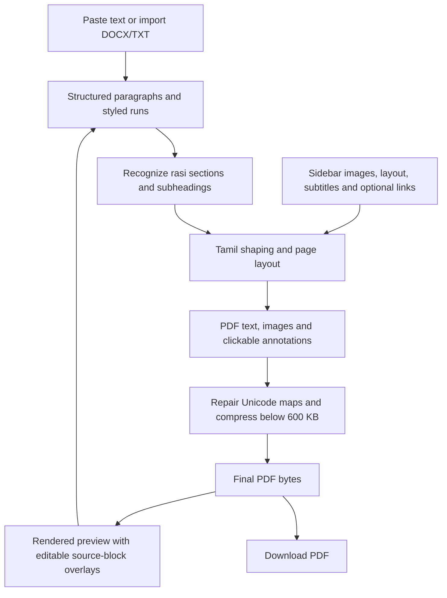

# Weekly Rasi PDF Generator

Source: [Crays-Server/rasipalanpdf](https://github.com/Crays-Server/rasipalanpdf) ? Branch: `main` ? Streamlit entry point: `app.py`

A separate Streamlit application for producing weekly Tamil rasi PDFs from pasted text, a Word document, or a UTF-8 text file. It uses the supplied assets and fonts in this folder. The earlier magazine app in `D:\pdf` is unchanged.

## Start locally

Python 3.11 is the tested version. No AI service, API key, database, Node.js build, Word installation, or Ghostscript is required.

```powershell
cd "D:\rasi palan"
python -m pip install -r requirements.txt
python -m streamlit run app.py
```

Open the URL Streamlit prints. During development, the app is also running at **http://localhost:8505**.

To start on that port yourself:

```powershell
python -m streamlit run app.py --server.port 8505
```

For a virtual environment:

```powershell
python -m venv .venv
.\.venv\Scripts\python.exe -m pip install -r requirements.txt
.\.venv\Scripts\python.exe -m streamlit run app.py
```

## Main workflow

1. Paste the raw article into the Article editor, or expand **Load article from Word or text** and load a `.docx` / `.txt` file. **Load supplied Raw.docx** opens your provided sample. Loading a file replaces the current article.
2. Rasi names are automatically recognized. The title/date paragraphs before the first rasi are treated as cover metadata; the date is overlaid on the supplied undated weekly cover. Predictions are taken from your article, not generated or rewritten.
3. Use the existing-style toolbar for headings, subheadings, bold, bullets, numbered lists, alignment, paragraph font size, and selected-character color. A selected word or full stop can have its own color. Font size is a paragraph-level setting.
4. Double-click text on the rendered PDF to edit its source block. Explicit line breaks use **Shift+Enter** or **LINE BREAK**. A block spanning multiple pages remains one source block and reflows after editing.
5. Turn **Auto preview refresh** off while making multiple edits, then click **REFRESH PREVIEW** once. **GENERATE PDF** refreshes stale content before exporting. With auto refresh on, edits update after a short typing pause.
6. Review every page, click **GENERATE PDF**, then **DOWNLOAD PDF**. The same compressed bytes supply the preview and export.

The app accepts any nonempty subset of the 12 rasis; all 12 need not be present. Duplicate rasi headings are rejected so content is not silently assigned to the wrong section. Exact names are the most reliable boundaries:

```text
மேஷம்
ரிஷபம்
மிதுனம்
கடகம்
சிம்மம்
கன்னி
துலாம்
விருச்சிகம்
தனுசு
மகரம்
கும்பம்
மீனம்
```

Short paragraphs ending with `:` are detected as subheadings. Lucky-color/direction/number lines use green; star-wise prediction text following the lucky section uses the reference's muted gold. The designer can override paragraph and selected-character colors.

## Images and layout controls

The sidebar provides:

- A selector for the front cover, back cover, both banners, footer logo, or any of the 12 zodiac images.
- An optional replacement upload for the selected slot: PNG, JPEG, or WebP; maximum 25 MiB and 40 megapixels per image.
- Show/hide, contain/cover fit, 1–3× zoom, horizontal movement, and vertical movement. Settings and uploaded bytes are retained separately for each slot while switching between slots.
- **Use supplied image** to restore that slot's bundled image.
- Per-rasi banner selection: **No banner**, **Banner 1**, or **Banner 2**. A banner is placed after the section's introductory paragraph; it moves to the next page if needed.
- Editable zodiac/star subtitles, extracted from the supplied reference and corrected for common pre-base-vowel extraction errors. Review spelling against your editorial source. Clearing a subtitle hides it.
- Optional front/back covers, optional page numbers, a cover-date override, default font size, line spacing, and a choice of Sundaram-01 or Sundaram-06 for headings.

Frame coordinates and page margins follow this rasi design. It does not reuse the previous magazine's tilted photo frames or bottom oval layout, which do not occur in this reference.

The cover artwork has a baked-in year (2026). The overlaid date can be changed each week. Supply a replacement cover if the baked year or artwork needs to change.

## Optional clickable links

Expand **Optional links** in the sidebar to edit or clear:

| Link | PDF destination |
| --- | --- |
| Banner link | Visible banner images |
| Footer / Android app link | Repeated footer logo and download label; app area on the back cover |
| Back-cover contact link | Contact/service area of the back cover |
| Back-cover email link | Email area of the back cover |

Defaults come from your supplied `asset/link` file. Clear a field to omit that link. Uncheck **Enable clickable PDF links** to omit all PDF links, including inline links.

To link selected text, select the word(s), enter an `https://`, `http://`, or `mailto:` URL in the toolbar, and click **APPLY LINK**. **REMOVE LINK** removes the selected text's link. PDF link annotations are generated from actual shaped text rectangles, including text flowing across pages. The raster preview shows the linked text's styling; the downloadable PDF contains the clickable annotations.

Only HTTP, HTTPS, and mailto links are accepted. No link is opened or fetched automatically during generation.

## Reference layout and typography

- Output is US Letter, **612 × 792 PDF points**, matching `reference.pdf`.
- Content rectangle: **[72, 72, 540, 690]**.
- Default body text: **21.96 pt**, with configurable line spacing (default 1.25×).
- A multi-line gray border, repeated footer logo/download label, colored rasi headings, red zodiac subtitles, blue subsection headings, and optional banner inserts recreate the supplied document structure.
- Zodiac headers can start below a preceding section, as in the reference. Paragraphs paginate automatically, and subheadings reserve room for following text.
- The default cover is `Weekly_Rasipalan_pdf_cover_new design_2026.jpg`; the weekly date is drawn over its lower area. The supplied `Cover page.jpg` contains an existing date and is retained as an alternate asset.
- The raw sample produces approximately **52 pages and 563 KB** with the current defaults. The supplied reference has 56 pages; page count is not fixed and changes with text, font size, line spacing, subtitles, and image settings.

The supplied Sundaram fonts contain Tamil ligatures with legacy glyph names. The renderer repairs PDF `ToUnicode` maps from the fonts' actual GSUB ligature rules so Tamil text remains extractable as Unicode. Visual placement and glyph outlines are unchanged. Some PDF text extractors split vowel marks across fragments or reorder them when coordinate sorting is enabled; normalize whitespace and Unicode when comparing extracted content.

## Strict size limit

Every successful export is **strictly below 600,000 bytes**, using decimal KB. The app preserves vector text and compresses embedded images rather than rasterizing entire pages.

Image preparation resizes artwork to its display rectangle. PDF serialization removes duplicates, deflates streams, subsets fonts, and compresses object streams. If necessary, larger image resources are recompressed at progressively smaller resolutions and quality settings. Each unique image is processed once per candidate, preventing repeated footer images from shrinking again on each page. Small footer/zodiac images are protected from that additional recompression.

If the limit cannot be met, generation reports an error. A very long issue or complex uploaded images may require reducing image detail, removing optional banners, or shortening the article. No oversized download is offered. The preview reflects the final compressed output.

## Project structure

```text
rasi palan/
├── app.py                         Streamlit UI and session/preview/export coordination
├── engine.py                      Rasi parsing, layout, images, links, compression, Unicode repair
├── text_engine.py                 Tamil validation and reusable PyMuPDF Story/bold drawing helpers
├── requirements.txt               Runtime Python dependencies
├── README.md
├── .gitignore
├── Raw.docx                       Supplied sample raw article
├── reference.pdf                  Visual reference; not needed for routine generation
├── editor/
│   └── index.html                 Rich-text editor and editable live PDF preview
├── asset/
│   ├── font/
│   │   ├── Uni Ila.Sundaram-01.ttf
│   │   └── Uni Ila.Sundaram-06.ttf
│   ├── zodiac/
│   │   └── 1.png ... 12.png
│   ├── zodiac_subtitles.json       Editable reference-derived subtitle defaults
│   ├── Weekly_Rasipalan_pdf_cover_new design_2026.jpg
│   ├── Cover page.jpg
│   ├── back cover page.jpg
│   ├── 1.jpg                      First banner
│   ├── 2.jpg                      Second banner
│   ├── footer.png
│   └── link                       Supplied editorial link list
├── tests/
│   ├── test_generator.py          Automated renderer regression checks
│   └── check_browser.py           Optional Playwright browser integration check
├── output/                        Generated PDFs; excluded from Git
└── tmp/                           QA renders/screenshots; excluded from Git
```

`asset/body-bold.ttf` and `asset/body-bold.source` are generated caches and are excluded from Git. Original supplied assets, the raw Word file, and the reference PDF are preserved locally. The runtime repository excludes the raw Word article, reference PDF, original editorial link list, and unused dated alternate cover. The sample-load button is unavailable when Raw.docx is not present; paste text or import your own Word file instead.

### Data flow



The frontend uses a custom Streamlit HTML component, with no external editor CDN. Content updates have a short debounce; manual mode skips PDF regeneration until requested. Revision and source-import tokens keep imported text and cached previews synchronized, including no-op edits and switching between automatic and manual modes.

Article runs support text, bold, optional `#rrggbb` color, and optional hyperlink URL. Blocks support heading, subheading, body, bullet, numbered list, alignment, and size. Backend validation escapes text before HTML shaping and validates URLs before adding PDF annotations.

## Requirements

| Package | Version range | Purpose |
| --- | --- | --- |
| Streamlit | `>=1.35,<2` | UI, component hosting, session state, uploads, downloads |
| PyMuPDF | `>=1.28,<2` | Shaping/layout, PDF assembly, links, rendering, compression |
| fonttools | `>=4.50,<5` | Font coverage, synthetic-bold asset, GSUB-based Unicode map repair |
| tzdata | `>=2024.1` | Asia/Kolkata timestamp support, including Windows |
| Pillow | `>=10.3,<13` | Image loading, EXIF orientation, crop/scale and encoding |

Word import uses Python's standard ZIP/XML libraries and does not require Microsoft Word or `python-docx`.

## Tests and verification

```powershell
cd "D:\rasi palan"
python -m unittest discover -s tests -v
```

The local tests and development requirements are excluded from the runtime repository. The generator tests cover the complete supplied raw article, Unicode preservation, all 12 rasis, the size limit, protected content bounds, selected-character color, clickable/disabled links, optional banners, repeated footer resolution, quote normalization, and invalid input.

The optional browser check requires Playwright separately:

```powershell
python -m pip install playwright
python -m playwright install chromium
# Start this app on port 8505 first:
python tests/check_browser.py
```

The browser check exercises actual preview editing, punctuation-only color, inline links, manual refresh, full raw-file loading, and exact pixel equality between the downloaded PDF and the displayed preview.

## Deployment and operations

This is a new app and has not been published to the existing magazine URL. Deploy it as a separate Streamlit application, using this folder's `app.py` as the entry point and the root `requirements.txt`. Include `engine.py`, `text_engine.py`, `editor/`, and all runtime `asset/` files. `Raw.docx` is needed only for the supplied-sample button; `reference.pdf`, tests, output, and QA images are not required for normal operation.

The app needs write permission for generated font caches and output files. Generated PDFs use unique names. Preview refreshes do not save PDFs; explicit generation does. Drafts, uploaded replacements, and crop settings are held in the current session and are not stored in a database. Download finished PDFs before ending a hosted session; local server output should not be treated as durable hosted storage.

When local, processing happens on your computer. When hosted, inputs are sent to the hosting server. There is no AI API call or separate article-processing service.

## Troubleshooting and limits

| Issue | Action |
| --- | --- |
| No rasi heading detected | Use an exact rasi name on its own line before its content |
| Duplicate rasi heading | Keep one section per rasi; do not repeat a sign name as a second section heading |
| Missing font/image | Restore the folder names and original asset filenames; Linux paths are case-sensitive |
| Unsupported character | Replace the reported symbol or supply a compatible complete font; curly quotes are normalized |
| Manual mode shows old pages | Click REFRESH PREVIEW after editing; outdated text overlays are disabled until refreshed |
| A title/subtitle is too long | Shorten it or reduce the relevant text size |
| Image pan seems ineffective | Increase zoom if the image already fits an axis with no crop room |
| Cannot meet 600 KB | Use simpler images, omit optional banners, or shorten the text |
| App uses an old editor | Restart Streamlit and hard-refresh the browser |
| Port already used | Stop the existing app or choose another `--server.port` |

Font size applies to a full paragraph/heading; inline font sizes are not implemented. Photo framing is controlled through fit, zoom, and pan, rather than free dragging. Subtitles and banner placement are editorial settings; prediction wording is never invented. The fixed yearly cover artwork must be replaced when needed. Supplied fonts/artwork remain subject to their respective owners' permissions; no new redistribution license is granted by this project.
